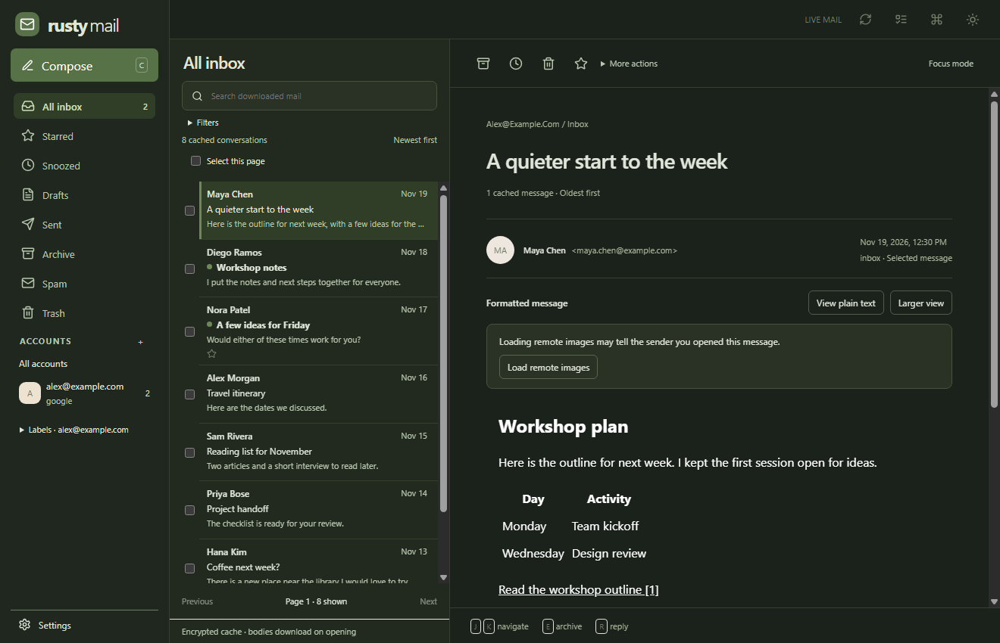
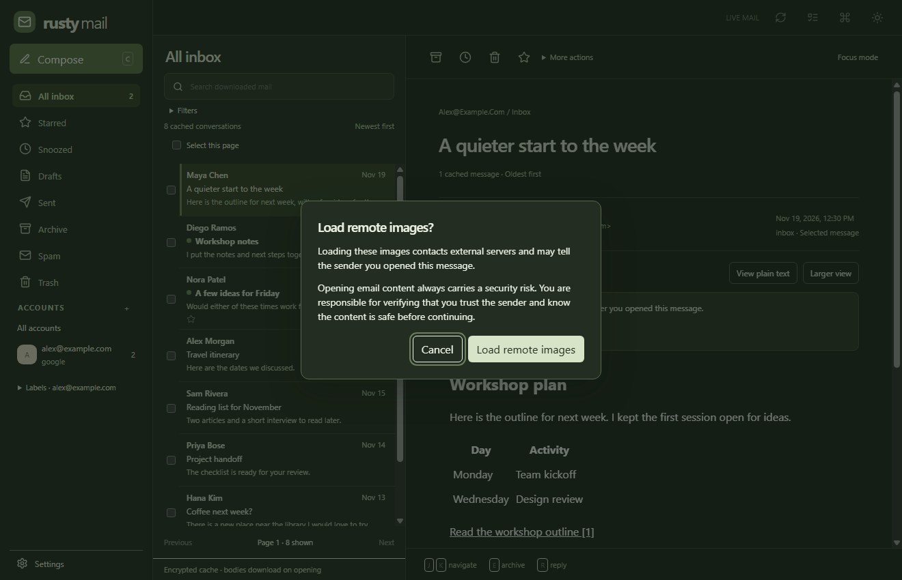

# Rusty Mail

Rusty Mail is a simple Windows email client for reading mail and writing replies. It’s an early-stage project built with Rust, Tauri, and Svelte. **Most of the code was written with AI assistance.**

## What it tries to be

1. **Read mail.** Open a conversation and choose formatted or plain-text view.
2. **Write a reply.** Reply to the selected message or save your reply as a draft.
3. **Choose what to open.** The reader asks for confirmation before loading images, saving attachments, or following links.

## Screenshots

The desktop interface shown with synthetic mail.





## Run on Windows

Install Node.js, Rust, the Microsoft C++ build tools, WebView2, and native Strawberry Perl for the default OpenSSL build.

```powershell
npm ci
npm run tauri dev
```

`npm run dev` opens the sample-only browser preview. For desktop account setup, see the [provider registration guide](docs/PROVIDER-REGISTRATION.md). Validation has focused on synthetic mail and local test servers. See [testing and known limits](docs/TESTING.md).

## License

Rusty Mail’s original code and assets are licensed under the [MIT License](LICENSE). Dependencies have their own licenses. See [third-party notices](THIRD_PARTY_NOTICES.md).
