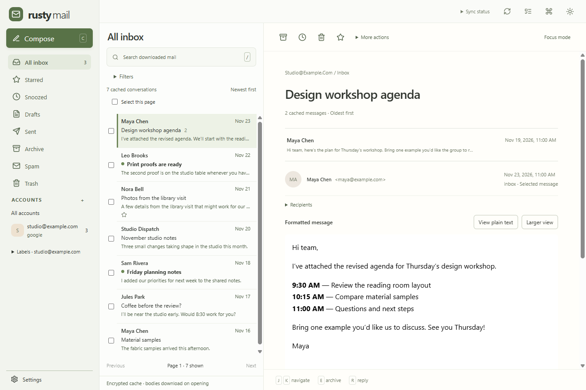
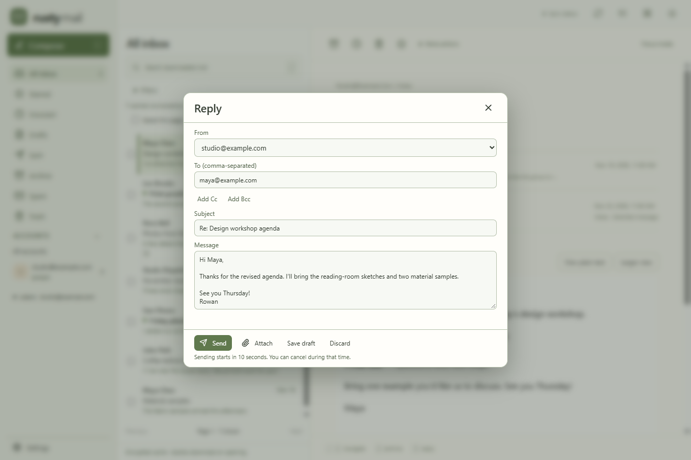
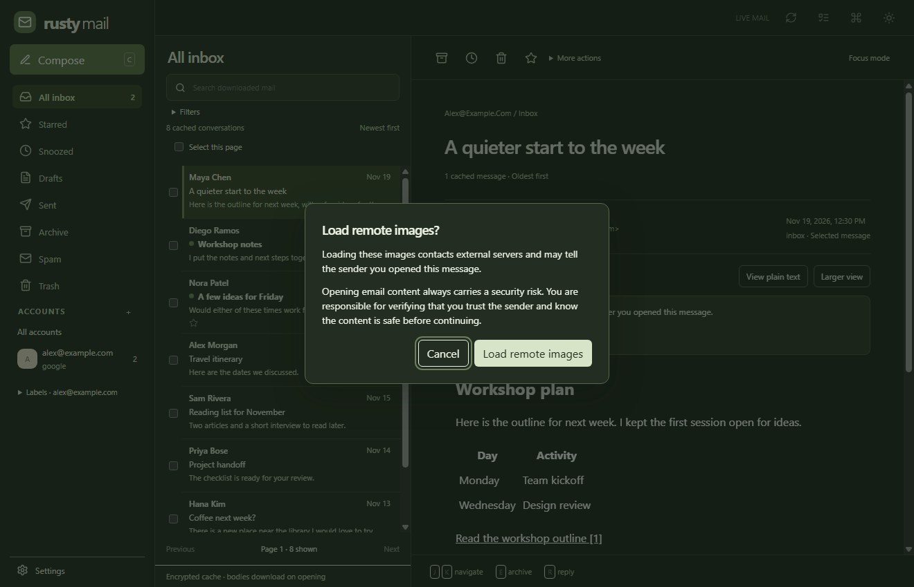
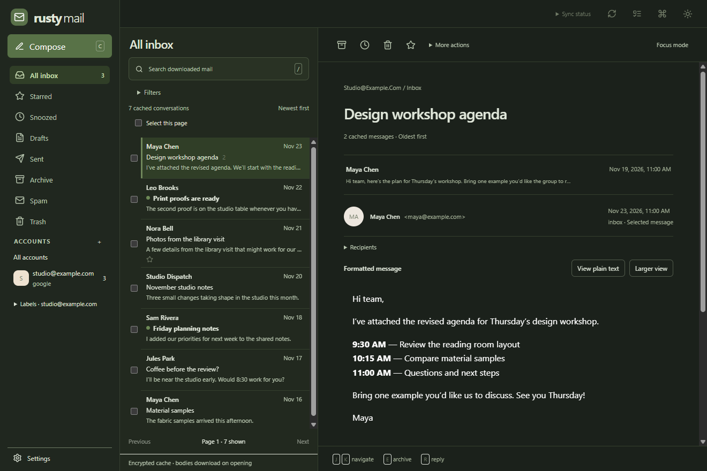

# Rusty Mail user manual

Rusty Mail is a Windows desktop client for reading, organizing, and sending email. The screenshots show the desktop interface with synthetic mail.

[Get started](#get-started) · [Read and organize](#read-and-organize-mail) · [Write and send](#write-and-send-mail) · [Images and attachments](#images-attachments-and-links) · [Appearance and shortcuts](#appearance-and-shortcuts) · [Troubleshooting](#troubleshooting)

## Get started

1. On Windows x64, extract the standalone ZIP and open `rusty-mail.exe`, or run the NSIS setup executable. The app uses Microsoft Edge WebView2.
2. Open **Settings** in the sidebar and scroll to **Email accounts**. The **＋** button next to **Accounts** opens the same settings.
3. Choose **Continue with Google** or **Continue with Microsoft** to sign in in your browser. Development builds require a registered desktop OAuth client. For iCloud, Fastmail, or a private server, choose **Add iCloud, Fastmail or custom IMAP/SMTP** and enter the mail credential or app password supplied by your provider. [Provider setup](PROVIDER-REGISTRATION.md)
4. Return to Rusty Mail and select **Synchronize** next to the connected account. The top-bar **Sync accounts** button synchronizes all connected accounts.

Rusty Mail stores cached messages and files in an encrypted local database. Windows Credential Manager stores mail credentials and authorization tokens. [Security and local storage](SECURITY.md)

## Read and organize mail

1. Select **All inbox** for the combined inbox, or select an address under **Accounts** to narrow the view. Provider folders or labels appear under the corresponding account when available.
2. Use **Search downloaded mail** to find messages in the local cache. **Filters** narrows results by unread status, sender address, or received date. Remove an individual filter using its chip, or select **Clear filters** to reset them together.
3. Select a conversation to open it. The reader lists cached messages oldest first. Select a message within the conversation to read or reply to it. **Recipients** shows the message’s addressing details when available.

Use the reader toolbar to archive, star, snooze, or move the selected message to Trash. **More actions** includes **Mark unread** and **Filter by this sender**. Use the checkboxes next to conversation rows for bulk actions. Snoozed mail stays visible in **Snoozed** until its local wake time. You can open it there and choose **End snooze** from the clock menu.

## Write and send mail

1. Select **Compose** for a new message, or choose **Reply**, **Reply all**, or **Forward** on the message you want to act on.
2. Check the sending account and recipients. For a forwarded message, select any original attachments you want to carry over and choose **Include selected attachments**. Use **Attach** to add a file from your computer.
3. Choose **Save draft** to reopen the message later from **Drafts**, or choose **Send**. Sending begins after 10 seconds. While it is pending, select **Cancel** in the outbox or **Mail operations** to stop it.

If a send is marked **uncertain**, check the provider’s Sent folder before trying again. Use **I checked Sent · dismiss** in **Mail operations** after reviewing the outcome.

## Images, attachments, and links

- Select **View plain text** to switch away from the formatted message. **Show formatting** switches back.
- Images start blocked. Choose **Load remote images** or **Show embedded images** and confirm to display supported images in the message. A remote image request may tell the sender you opened the message.
- Select **Enable links in message** to make links clickable in the formatted body. Clicking a link shows its destination before opening it. You can also review destinations under **Links in this message**.
- Select an attachment to review its name before saving.
- The reader’s **AI tools** require a configured model. A hosted model requires consent before it can receive the selected message. [AI and data sharing](SECURITY.md)

## Appearance and shortcuts

Select the sun icon (**Change theme**) in the top bar to switch between light and dark. **Focus mode** hides the folder and conversation panes. **Settings** also includes language, reading size and width, a compact list, signatures, and Windows notification preferences.

| Key | Action |
| --- | --- |
| `/` | Focus mail search |
| `J` / `K` | Move through conversations |
| `C` | Compose |
| `R` | Reply to the selected message |
| `E` | Archive the selected message |
| `Ctrl`+`K` | Open Commands |

## Troubleshooting

| What you see | What to do |
| --- | --- |
| An account shows **Sync needs attention** | Open **Sync status**, check the account’s error, then retry that account. Reconnect if the provider revoked authorization. |
| Search misses an older message | Clear filters, check the selected account and folder, and synchronize. Search covers downloaded mail. |
| Sign-in says the client ID is missing | Complete the desktop registration and relaunch the app with the configured variables. [Provider setup](PROVIDER-REGISTRATION.md) |
| A message body failed to download | Select **Try again** in the reader after checking the connection. |

[Back to the project README](../README.md)
